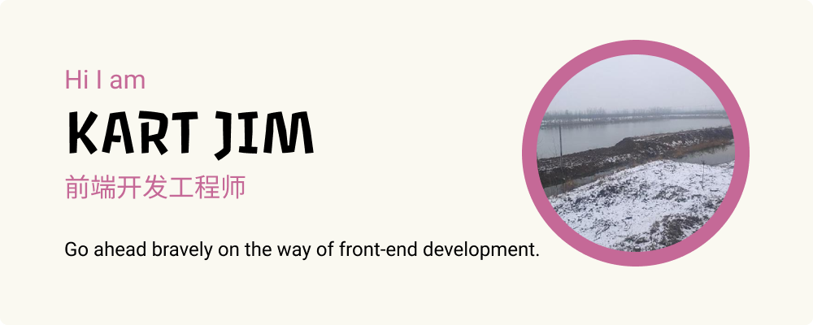

  

## Hi there,I`m kart jim 👋

>  I'm Self-taught Front-end developer from China. 😉

- :low_brightness: I’m currently Learning How to coding with AI.
- :golf: I’m also currently learning Rust.
- :speech_balloon: Ask me about anything. I will try to help you as much as I can.
- :eyes: Welcome to invite me to do some Front-end projects.

## Tech & Tools Preference

  
 

 
 
 
 
 

## 🌐 Socials:
    

## 📊 GitHub Stats:
 
 

